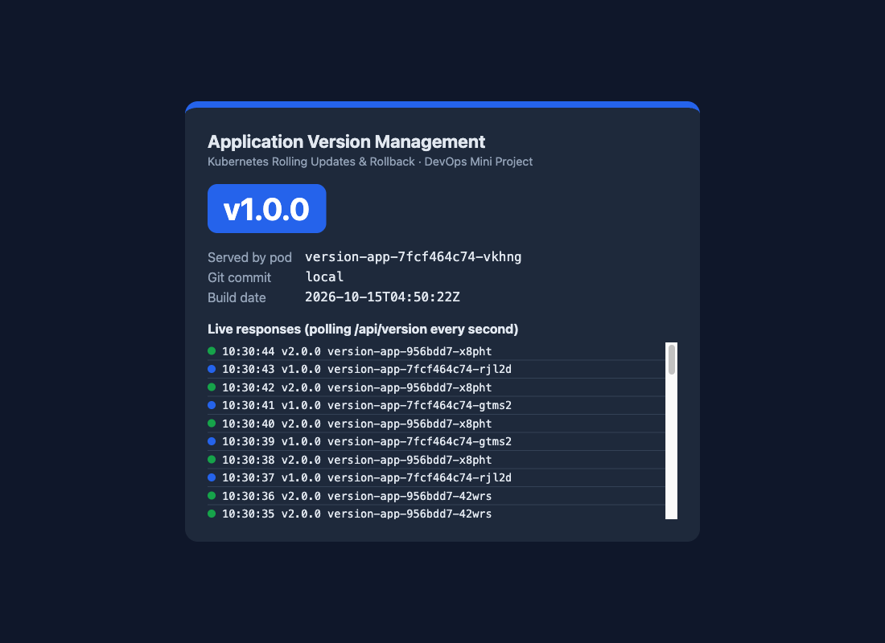
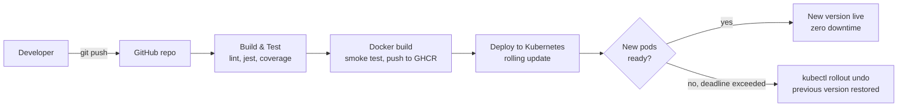

# Application Version Management Using Kubernetes Rolling Updates and Rollback

DevOps Mini Project (Activity 2) · Group 42

| Roll No. | Name |
|---|---|
| 16010123163 | Kanan Goenka |
| 16010123164 | Kanishk Gandecha |
| 16010123171 | Keshav Rathi |

A complete software delivery pipeline for a small web service, `version-app`, whose job is to make
**application versions visible**. Each release shows its version number, colour and the pod that served it,
so you can watch Kubernetes replace one version with another **without downtime**. You can also watch it **reject a
faulty release and roll back** automatically.



## What the project covers

| Requirement | Implementation |
|---|---|
| Version control | Git + GitHub, `main` branch protected by the CI pipeline |
| Application build | Node.js 22 / Express 5 service (`src/`) |
| Automated testing | ESLint + Jest/Supertest, 13 tests, coverage gate ≥ 80 % (`tests/`) |
| Containerisation | Multi-stage `Dockerfile`, non-root user, health check, version baked in as build arg |
| CI/CD | GitHub Actions: Build & Test → Docker Build & Publish (GHCR) → Deploy to Kubernetes (`.github/workflows/ci-cd.yml`) |
| Deployment | Kubernetes Deployment with `RollingUpdate` strategy, readiness/liveness probes, revision history (`k8s/`) |
| Version management | Rolling update, automatic rollback on failure, rollback to any revision (`scripts/`) |

## Architecture



Inside the cluster, a `Service` load-balances across 4 pods. During an update, the Deployment creates a new
ReplicaSet and shifts pods across one at a time (`maxSurge: 1`, `maxUnavailable: 0`). A new pod only receives
traffic after its readiness probe (`/ready`) passes. Every old ReplicaSet is kept (`revisionHistoryLimit: 10`),
so you can roll back to it.

## Project structure

```
├── src/                  Express app (config, routes, HTML page, graceful shutdown)
├── tests/                Jest + Supertest tests
├── Dockerfile            Multi-stage image; APP_VERSION / SIMULATE_FAILURE build args
├── k8s/                  Namespace, Deployment (RollingUpdate), NodePort Service, kustomization
├── scripts/              Cluster setup, build, deploy, update, rollback, status, verify, traffic watcher
├── .github/workflows/    CI/CD pipeline
└── docs/                 Project report content, demo guide, screenshots
```

## Application endpoints

| Endpoint | Purpose |
|---|---|
| `GET /` | Web page showing the version, pod name and a live log of responses |
| `GET /api/version` | JSON version metadata (version, colour, commit, build date, pod) |
| `GET /health` | Liveness probe |
| `GET /ready` | Readiness probe; returns 503 for a faulty build or while shutting down |

## Running it locally

Prerequisites: Docker Desktop, minikube, kubectl, Node.js ≥ 20.

```bash
npm ci && npm run lint && npm test        # build & test

./scripts/setup-cluster.sh                 # start minikube profile "devops-mini"
./scripts/build-image.sh 1.0.0             # build images and load them into the cluster
./scripts/build-image.sh 2.0.0
./scripts/build-image.sh 3.0.0 --broken    # faulty release for the rollback demo

./scripts/deploy.sh                        # deploy v1.0.0
./scripts/open-app.sh                      # open the app in the browser (keep this terminal open)
./scripts/watch-traffic.sh                 # (2nd terminal) live traffic from inside the cluster
```

The scripts always pass `--context devops-mini`, so they never touch any other cluster in your kubeconfig.

## Version management operations

```bash
./scripts/update.sh 2.0.0 "Release v2.0.0 - new green UI"   # rolling update
./scripts/update.sh 3.0.0 "Release v3.0.0 - faulty build"   # fails readiness -> auto rollback
./scripts/status.sh                                          # ReplicaSets, pods, rollout history
./scripts/rollback.sh                                        # undo to previous revision
./scripts/rollback.sh 1                                      # roll back to a specific revision
./scripts/verify.sh 1.0.0                                    # assert the Service serves v1.0.0
```

Under the hood these run `kubectl patch` (image + `kubernetes.io/change-cause`), `kubectl rollout status`,
`kubectl rollout undo [--to-revision=N]` and `kubectl rollout history`.

## CI/CD pipeline

`.github/workflows/ci-cd.yml` runs on every push and pull request to `main`:

1. **Build & Test**: `npm ci`, ESLint, Jest with an 80 % coverage gate, and the coverage report uploaded as an artifact.
2. **Docker Build & Publish**: builds the image with the version from `package.json`, smoke-tests the container
   (`/health`, `/ready`, version check), then pushes `:<version>`, `:sha-<commit>` and `:latest` to GitHub Container Registry
   (pushes to `main` only). It also saves the image as an artifact, so the deploy job uses the exact image that was tested.
3. **Deploy to Kubernetes**: creates a kind cluster and deploys a baseline v1.0.0, then:
   - starts a continuous in-cluster traffic probe
   - runs a **rolling update** to the new version and verifies every response comes from it
   - runs a **rollback drill**: deploys a deliberately faulty release, expects the rollout to fail, and checks that
     the automatic rollback restored the good version
   - fails the pipeline if any request failed or was served by the faulty release, and writes a deployment
     report (including `rollout history`) to the job summary.

To release a new version, bump `version` in `package.json` and push.

## Results

From the local run captured in `docs/screenshots/`:

- v1 → v2 rolling update: pods replaced one at a time, old and new versions served side by side, no errors.
- Faulty v3: the new pod failed readiness (HTTP 503), the four v2 pods kept serving, and once the 60 s progress deadline passed the script rolled back automatically.
- Rollback to revision 1 restored v1.0.0. Verified with 8 load-balanced requests.
- **531 requests during all of the above: 0 failed, 0 served by the faulty release.**

See [docs/DEMO_GUIDE.md](docs/DEMO_GUIDE.md) for the live demonstration script and
[docs/PROJECT_REPORT.md](docs/PROJECT_REPORT.md) for the full report.
