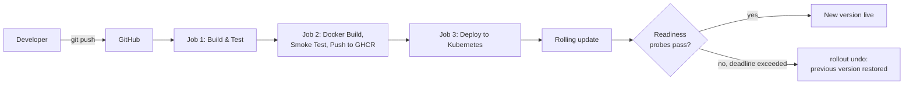
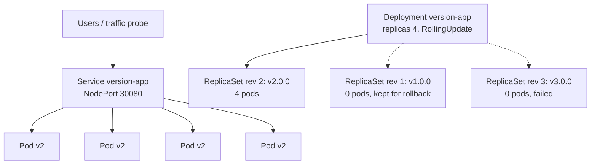

# Application Version Management Using Kubernetes Rolling Updates and Rollback

**DevOps Mini Project: Activity 2 · Group 42**

| Roll No. | Name |
|---|---|
| 16010123163 | Kanan Goenka |
| 16010123164 | Kanishk Gandecha |
| 16010123171 | Keshav Rathi |

---

## 1. Abstract

Releasing a new version of an application is one of the riskiest moments in its life. If the old version is
stopped before the new one is ready, users see downtime. If the new version is faulty, users see errors until
someone notices and reverts. This project builds a complete DevOps delivery pipeline for a containerised web
service and uses Kubernetes Deployments to manage its versions. New versions are released with **rolling updates**,
gated by readiness probes, so capacity never drops. A faulty version is detected automatically and **rolled back**
to the last good revision. The pipeline covers version control (Git/GitHub), build, automated testing (Jest),
containerisation (Docker), CI/CD (GitHub Actions) and deployment to Kubernetes (minikube locally, kind in CI).
In our test run, 531 requests were sent during a rolling update, a failed release with automatic rollback, and a
manual rollback. None of them failed, and none was served by the faulty version.

## 2. Introduction and Problem Statement

Traditional deployments stop the running version, install the new one and start it again. This "recreate" approach
has two problems:

1. **Downtime**: no instance serves users between stop and start.
2. **Slow, manual recovery**: if the new version is broken, someone has to notice, find the previous artefact and
   redeploy it by hand.

Kubernetes Deployments solve both problems declaratively. You describe the desired version, and the
Deployment controller moves the cluster towards it gradually while keeping a history of previous versions.
This project shows that mechanism end to end, from a `git push` to a verified, zero-downtime release with
automatic rollback.

## 3. Objectives

1. Develop a small web application that exposes its version, so you can see which version is serving each request.
2. Automate build, lint and testing, with a minimum code-coverage gate.
3. Package the application as a versioned, secure Docker image.
4. Deploy it to Kubernetes with a zero-downtime `RollingUpdate` strategy and health probes.
5. Show rollback both automatically (on a failed rollout) and manually (to any stored revision).
6. Automate the whole flow with a CI/CD pipeline in GitHub Actions.
7. Measure availability during updates and rollbacks.

## 4. Tools and Technologies

| Area | Tool | Use in this project |
|---|---|---|
| Version control | Git, GitHub | Source repository, triggers the pipeline on push / pull request |
| Application | Node.js 22, Express 5 | `version-app` web service |
| Testing | Jest, Supertest, ESLint | Unit and HTTP integration tests, static analysis, coverage gate |
| Containerisation | Docker (multi-stage build) | Versioned image, non-root, health check |
| Registry | GitHub Container Registry (GHCR) | Stores released images tagged by version and commit |
| CI/CD | GitHub Actions | 3-stage pipeline: test → image → deploy |
| Orchestration | Kubernetes (minikube locally, kind in CI) | Deployment, ReplicaSets, Service, probes |
| Automation | Bash scripts, kubectl, kustomize | Update, rollback, status, verification, traffic probe |

## 5. System Architecture

**Inside the cluster**

Each version of the pod template becomes its own **ReplicaSet**. A rolling update scales the new ReplicaSet up and
the old one down, one pod at a time. A rollback scales an old ReplicaSet back up. The Service selects pods by
label (`app=version-app`) and sends traffic only to pods whose readiness probe passes.

## 6. Implementation

### 6.1 Application (`src/`)

- `GET /`: HTML page showing the version badge (a different colour per major version), the serving pod, the commit,
  the build date, and a live log that polls `/api/version` every second.
- `GET /api/version`: JSON metadata. Sends `Connection: close` so each request is load-balanced again, which makes the mix
  of versions visible during an update.
- `GET /health`: liveness.
- `GET /ready`: readiness. Returns **503** if the image was built with `SIMULATE_FAILURE=true` (our "faulty
  release") or while the pod is shutting down.
- Graceful shutdown on `SIGTERM`: readiness turns off, in-flight requests finish, then the process exits.

### 6.2 Automated testing (`tests/`)

13 Jest/Supertest tests cover configuration, every endpoint, response headers, HTML escaping, faulty-build
readiness and shutdown readiness. ESLint runs before the tests. Jest enforces a **coverage threshold of 80 %**;
the actual coverage is 100 % of statements and 94.7 % of branches (Fig. 1).

### 6.3 Containerisation (`Dockerfile`)

- Multi-stage build: the dependency stage runs `npm ci --omit=dev`, and the runtime stage copies only `node_modules` and `src`.
- `APP_VERSION`, `GIT_COMMIT` and `BUILD_DATE` are build arguments baked into the image, so **one image tag = one version**.
- `SIMULATE_FAILURE` build argument produces the faulty release used in the rollback demonstration.
- Runs as the unprivileged `node` user, with a Docker `HEALTHCHECK` on `/health`.

### 6.4 Kubernetes manifests (`k8s/`)

| Setting | Value | Why |
|---|---|---|
| `replicas` | 4 | Enough pods to see a gradual shift |
| `strategy.type` | RollingUpdate | Replace pods gradually |
| `maxSurge` / `maxUnavailable` | 1 / 0 | Never fewer than 4 ready pods → zero downtime |
| `minReadySeconds` | 5 | New pod must stay ready 5 s before it counts |
| `progressDeadlineSeconds` | 60 | Rollout is marked failed after 60 s without progress |
| `revisionHistoryLimit` | 10 | Old ReplicaSets kept for rollback |
| `readinessProbe` | `GET /ready` every 3 s | Gate traffic to new pods |
| `livenessProbe` | `GET /health` every 10 s | Restart hung containers |
| `preStop` | `sleep 5` | Let the Service drop the endpoint before SIGTERM |
| `kubernetes.io/change-cause` | release note | Shown in `kubectl rollout history` |
| Security | non-root, read-only root FS, all capabilities dropped | Hardening |

A NodePort Service (port 30080) load-balances across the pods.

### 6.5 Version-management scripts (`scripts/`)

| Script | What it does |
|---|---|
| `update.sh <ver> "<cause>"` | Patches image + change-cause in one step, waits with `kubectl rollout status`; on failure runs `kubectl rollout undo` |
| `rollback.sh [rev]` | `kubectl rollout undo` to the previous or a specific revision |
| `status.sh` | Deployment, ReplicaSets with revision numbers, pods, rollout history |
| `verify.sh <ver>` | Sends N requests through the Service and fails if any came from another version |
| `watch-traffic.sh` | In-cluster client calling the Service every 0.5 s and counting successes and failures |

### 6.6 CI/CD pipeline (`.github/workflows/ci-cd.yml`)

| Job | Steps |
|---|---|
| **1. Build & Test** | checkout → Node 22 → `npm ci` → ESLint → Jest + coverage gate → upload coverage report |
| **2. Docker Build & Publish** | read version from `package.json` → build image → smoke test container (`/health`, `/ready`, version check) → save image as artifact → push `:<version>`, `:sha-<commit>`, `:latest` to GHCR (on `main`) |
| **3. Deploy to Kubernetes** | create kind cluster → load the *same* tested image → deploy baseline v1.0.0 → start traffic probe → **rolling update** to the new version → verify → **rollback drill** with a faulty release (must fail and auto-revert) → verify again → fail the job if any request failed or reached the faulty version → write the deployment report and rollout history to the job summary |

Pull requests run jobs 1–2. Pushes to `main` run all three.

## 7. Results

| Figure | File (docs/screenshots/) | Shows |
|---|---|---|
| 1 | `01-lint-and-tests.png` | ESLint clean, 13/13 tests pass, coverage table |
| 2 | `02-docker-build.png` | Multi-stage Docker build and resulting images |
| 3 | `03-cluster-and-deploy-v1.png` | Kubernetes node and initial deployment of v1.0.0 (4 pods) |
| 4 | `04-app-v1-running.png` | Browser: v1.0.0 (blue) |
| 5 | `05-rolling-update-v1-to-v2.png` | `update.sh 2.0.0`: rolling update progress |
| 6 | `05b-pods-mid-rollout.png` | Pods mid-rollout: v1 and v2 side by side |
| 7 | `06-app-during-rolling-update.png` | Browser log switching from v1 pods to v2 with no failed requests |
| 8 | `07-app-v2-after-update.png` | Browser: v2.0.0 (green) |
| 9 | `08-faulty-release-auto-rollback.png` | Faulty v3.0.0: progress deadline exceeded → automatic rollback to v2.0.0 |
| 10 | `08b-readiness-probe-failures.png` | Readiness probe failed (HTTP 503) events; ReplicaSet scaling events |
| 11 | `09-revisions-and-history.png` | ReplicaSets per revision and `rollout history` with change-causes |
| 12 | `10-rollback-to-revision-1.png` | Manual `rollout undo --to-revision=1`, verified with 8 requests |
| 13 | `11-app-after-rollback-v1.png` | Browser: back on v1.0.0 |
| 14 | `12-zero-downtime-traffic.png` | Traffic probe: 531 requests, 0 failed, 0 served by v3 |
| 15 | `13-deployment-manifest.png` | Deployment manifest (strategy and probes) |
| 16 | `14-cicd-pipeline-stages.png` | Pipeline jobs and steps |
| 17 | *(add after first push)* | GitHub Actions run: three green jobs + Deployment report summary |

**Observations**

- **Rolling update (v1 → v2):** the ReplicaSet events show the new ReplicaSet scaling 1 → 4 and the old one 4 → 0,
  one pod at a time about every 8 s. Ready pods never dropped below 4.
- **Faulty release (v3):** exactly one v3 pod was created (maxSurge = 1). It failed readiness 21 times with HTTP 503
  and never received traffic. The 4 v2 pods were never terminated because maxUnavailable = 0. After 60 s the Deployment
  reported `ProgressDeadlineExceeded`, and `update.sh` rolled back automatically.
- **Rollback to revision 1:** restored v1.0.0. Kubernetes re-records it as a new revision (5), which is why revision 1
  disappears from the history.
- **Availability:** 531 / 531 requests succeeded (100 %). 153 were served by v1.0.0, 378 by v2.0.0, and **0 by the faulty v3.0.0**.

## 8. Conclusion

The project delivers a working pipeline from commit to production-like deployment. Kubernetes Deployments,
combined with readiness probes and a conservative rolling-update strategy, made version changes non-disruptive.
A faulty release could not reach users, and recovery from it was automatic. Because every image carries its own
version and every revision carries a change-cause, the cluster is always auditable: you can see which version runs
where, why it changed, and how to return to any earlier state with one command.

## 9. Future Scope

- Canary or blue-green releases with traffic splitting (Argo Rollouts, or a service mesh such as Istio).
- Automated rollback based on metrics such as error rate and latency from Prometheus, not only readiness.
- Helm chart packaging and GitOps deployment with Argo CD.
- Deployment to a managed cluster (EKS/GKE/AKS) with environment promotion (dev → staging → prod).
- Image vulnerability scanning (Trivy) as a pipeline gate.

## 10. References

1. Kubernetes documentation: Deployments, "Updating a Deployment", "Rolling Back a Deployment". https://kubernetes.io/docs/concepts/workloads/controllers/deployment/
2. Kubernetes documentation: Configure Liveness, Readiness and Startup Probes. https://kubernetes.io/docs/tasks/configure-pod-container/configure-liveness-readiness-startup-probes/
3. Docker documentation: Multi-stage builds. https://docs.docker.com/build/building/multi-stage/
4. GitHub Actions documentation. https://docs.github.com/actions
5. kind: Kubernetes IN Docker. https://kind.sigs.k8s.io/
6. minikube documentation. https://minikube.sigs.k8s.io/docs/
